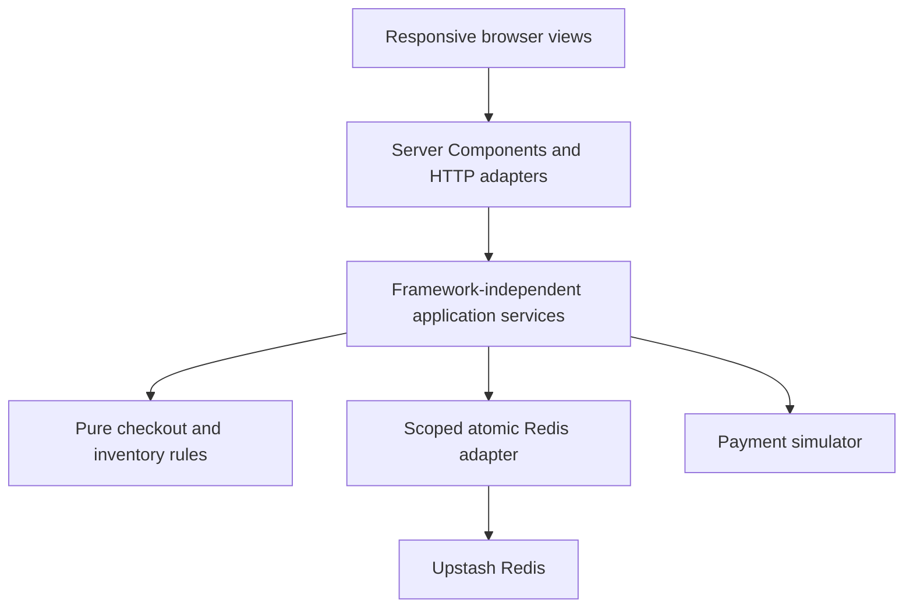

# GameTime Checkout Continuity

A responsive ticket-marketplace assessment: select tickets on one device, open the
same checkout on another, and keep the same exclusive reservation, current price,
and fixed expiration deadline. Payment, price changes, expiration, and recovery
are decided on the server and persisted in Redis.

**Everything is synthetic:** four fictional 2027 events at real venues, invented
schedules/listings/prices, and simulated purchases. No real tickets, charges, buyer
accounts, or affiliation with GameTime are represented.
Bundled photography is documented in [image credits](docs/IMAGE_CREDITS.md).

## Run locally

Use Node 24 LTS and npm (minimum supported Node: 22.12).

```sh
npm ci
cp .env.example .env.local
# Fill .env.local using the table below and docs/DEPLOYMENT.md.
npm run dev
```

Open [localhost:3000](http://localhost:3000). Discovery can render before Redis is
configured; ticket reservations and checkout require the Redis configuration.
A local TCP Redis installation alone does not satisfy the app's HTTPS REST client.
Local integration tests launch their own Redis; the running app uses Upstash.

| Server variable              | Value                                                                 |
| ---------------------------- | --------------------------------------------------------------------- |
| `UPSTASH_REDIS_REST_URL`     | Your account-owned Upstash database's HTTPS REST endpoint             |
| `UPSTASH_REDIS_REST_TOKEN`   | Its read/write REST token, not a read-only token                      |
| `CHECKOUT_NAMESPACE`         | Stable isolated namespace, e.g. `gametime-local-richard`              |
| `CHECKOUT_CALLER_SECRET`     | Random secret, at least 32 characters                                 |
| `CHECKOUT_COMPLETION_SECRET` | A different random secret, at least 32 characters                     |
| `DEMO_MODE`                  | `false`; set `true` to enable guarded assessor controls               |
| `DEMO_SECRET`                | Separate random secret, at least 32 characters; required in demo mode |
| `PAYMENT_SCENARIO`           | `SUCCESS` by default; alternative base scenarios require demo mode    |

Generate each secret independently with `openssl rand -hex 32`. Put values only
in the ignored root `.env.local` or hosting environment settings. Never prefix
credentials with `NEXT_PUBLIC_`, embed them in source, or commit the populated file.
Keep namespaces and signing secrets stable across instances/redeploys; isolate
local, Preview, and Production data. Missing/invalid runtime settings fail closed.

[Upstash + Vercel setup guide](docs/DEPLOYMENT.md) gives exact console steps,
variable mappings, file responsibilities, publication commands, and smoke checks.
**No deployment or GitHub publication has been performed in this environment.**

## Five-minute reviewer walkthrough

1. Browse the four seeded events (football, basketball, concert, baseball), open an
   event, and choose a section, quantity, and contiguous seats or GA admission.
   Every price includes explicit per-ticket fees. Reserve the selected tickets.
2. In an independent browser/profile, revisit the event: those units are held.
   Open the original checkout URL using Copy link or its QR on another device.
   Both views share the same selection, price state, and server deadline; opening
   another view creates no second hold. A real phone needs a reachable HTTPS URL.
3. With demo mode enabled, open **Developer menu** (desktop Popover; mobile vertical
   ellipsis/right Sheet). Enter DEMO_SECRET on that device to unlock this checkout.
   Increase price: payment blocks until the exact new quote is acknowledged.
   Decrease price: the savings notice appears automatically. Other views poll.
4. Set the hold to 1–30 minutes from server now, or **Expire now**. An already-open
   checkout returns to its event and inventory is restored. Separately paste that
   expired URL into a fresh navigation: one replacement reservation is attempted
   using current availability/pricing; unavailable intent returns to the event.
5. On a fresh checkout, select **Transient timeout**, submit, and explicitly retry.
   The override is consumed once; default SUCCESS then completes. Select transient
   again before each retry to reach three total attempts. **Definitive decline**
   ends that checkout. **Clear simulation** restores the configured base scenario
   without resetting attempts. Processing protects inventory under its own deadline.
6. Complete from one device: it receives a refreshable confirmation. Other observing
   devices return home. Competing submissions still create one order. Completed
   checkout links return home; confirmation access is not shared by the checkout URL.

**Reset demo data** requires typing `RESET DEMO DATA`. It invalidates _every_
checkout/confirmation in the configured namespace and resets fixture inventory.
Give the demo secret only to trusted assessors; ordinary shoppers cannot reset or
mutate scenarios. [Developer API/security details](docs/DEVELOPER_CONTROLS.md).

## Architecture and invariants

Next.js App Router / React 19 provide server-rendered event and checkout summaries;
small Client Components handle interactions. Tailwind 4, local shadcn/Radix
primitives, Lucide, and bundled imagery provide one responsive interface. TanStack
Query polls active state about every two seconds and on focus/reconnect. The
countdown ticks locally from server timestamps plus monotonic elapsed time.



| State             | Allowed next behavior                                                  |
| ----------------- | ---------------------------------------------------------------------- |
| ACTIVE            | Acknowledge changed price, claim payment, or expire                    |
| PRICE_REVIEW      | Accept exact current quote; payment remains blocked                    |
| PROCESSING        | Settle the claimed attempt or fence it at processing timeout           |
| PAYMENT_RETRYABLE | Explicit new attempt while hold is live; at most three total           |
| PAYMENT_FAILED    | Terminal decline, exhaustion, or processing timeout; release stock     |
| EXPIRED           | Mounted page leaves; fresh navigation may create one new successor     |
| COMPLETED         | One durable order; only the completing caller/key obtains confirmation |

Reservations immediately exclude stock from other carts. An atomic claim validates
ownership, session/quote versions, acknowledgement, inventory and time. Claims
before expiry protect payment independently of the original countdown. Ordinary
reads/retries never extend a hold. Successful settlement atomically sells inventory
and writes the order plus a permanent session-level completion receipt.

Three separate time horizons matter: **10-minute business hold**, **60-second
processing window**, and **30-minute recovery horizon after hold expiry**. Temporary
coordination metadata is then retained an additional 24 hours for replay cleanup.
Redis TTL never frees stock or authorizes a claim. Orders/receipts remain durable
unless an explicit synthetic-data reset is confirmed. Confirmation cookies last
seven days; there is no account-based receipt recovery after losing that cookie.

Redis primary-routed snapshot/EVAL + CAS/MSET validates the scoped read set and
commit-time boundary. Independent listings do not read or conflict on historical
purchases. Inventory retains active holds and compact sold occupancy; temporary
session histories are bounded to three attempts. A generation fence makes reset
safe against old serverless instances. [ARCHITECTURE.md](ARCHITECTURE.md) covers
consistency boundaries, SSR judgment, API routes, and tradeoffs.

## Tests and validation

Integration/E2E tests require Redis server + CLI >=6.2 and openssl. On macOS,
`brew install redis openssl`; tests start and stop disposable Redis themselves.
They never flush or reset your configured Upstash database.

```sh
npx playwright install --with-deps chromium
npm run check
# Individual suites:
npm run format:check
npm run lint
npm run typecheck
npm test
npm run test:integration
npm run build
npm run test:http
npm run test:browser
# After exporting actual REST credentials (isolated generated live-test namespace):
npm run test:upstash
```

`npm run check` includes all non-hosted commands above, including build before HTTP
and browser tests. `npm run format` applies required braces/1TBS and section spacing
via ESLint, then the supplied Prettier settings. For a production server, run
`npm run build` then `npm start`. CI runs the same gate on Node 24.

See [acceptance evidence](docs/ACCEPTANCE_MATRIX.md) and
[validation results/limitations](docs/VALIDATION.md) for actual counts and scope.
Local Redis tests exercise real atomicity; application-model tests alone do not.
Hosted Upstash, physical-device testing, remote CI, and Vercel smoke tests require
external setup and are not represented as verified.

## Observability and tradeoffs

Structured server logs use the names `checkout_created`, `checkout_resumed`,
`hold_expired`, `recovered`, `price_changed`, `price_acknowledged`,
`payment_attempted`, `checkout_completed`, and `checkout_failed`. They include
session ID, version, server time, source surface (`ssr`, `http`, `demo`, or
`application`), and the original typed domain event. Additional decrease/retry
signals remain available. Secrets, caller cookies, payment data and capabilities
are not logged. Surface describes execution origin, not a verified device identity.

A useful funnel is distinct created sessions → acknowledged quotes when required →
attempted payment → completed orders, with recovery and failures measured separately.
Resume counts are page visits (including the initial valid navigation), not unique
people. Deduplicate by session/version/event and use durable orders as conversion
truth. Logs are best effort, not an outbox: crashes and lazy expiry reconciliation
can omit events, repeated navigation can add observations, and recovery creates a
new session. This prototype does not claim exact analytics delivery or identity.

Polling trades modest synchronization delay and Redis traffic for operational
simplicity. Listing-level CAS serializes competing stock claims; it is not a
large-marketplace sharding benchmark. All inventory requires non-evicting durable
Redis data. No payment/provider, real authentication, email/ticket delivery, or
seat-map integration exists. Production work would add provider idempotency and
webhook reconciliation for uncertain captures, account-based receipts, authorization,
rate limiting, durable telemetry, accessibility/device testing, and capacity testing.
See [remaining limitations](docs/VALIDATION.md#remaining-limitations).
