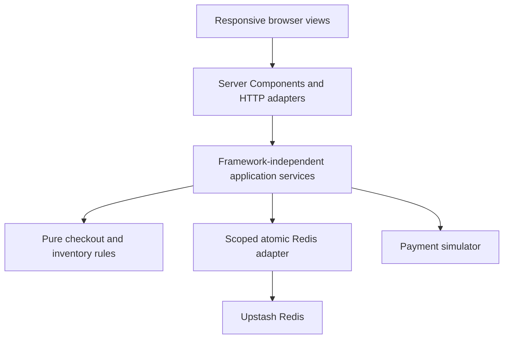

# GameTime Checkout Continuity

A responsive ticket-marketplace assessment: select tickets on one device, open the same checkout on another, and keep the same exclusive reservation, current price, and fixed expiration deadline. Payment, price changes, expiration, and recovery are decided on the server and persisted in Redis.

- Live demo: [Open the application](YOUR_VERCEL_URL)
- Source: [GitHub repository](YOUR_GITHUB_URL)

**Everything is synthetic:** four fictional 2027 events at real venues, invented schedules/listings/prices, and simulated purchases. No real tickets, charges, buyer accounts, or affiliation with GameTime are represented. Developer controls require a separate unlock secret supplied privately to reviewers. Bundled photography is documented in [image credits](docs/IMAGE_CREDITS.md).

## Run locally

Use Node 24 LTS and npm (minimum supported Node: 22.12).

```sh
npm ci
cp .env.example .env.local
# Fill .env.local using the table below and docs/DEPLOYMENT.md.
npm run dev
```

Open [localhost:3000](http://localhost:3000). Discovery can render before Redis is configured; ticket reservations and checkout require the Redis configuration. A local TCP Redis installation alone does not satisfy the app's HTTPS REST client. Local integration tests launch their own Redis; the running app uses Upstash.

| Server variable | Value |
| --- | --- |
| `UPSTASH_REDIS_REST_URL` | Your account-owned Upstash database's HTTPS REST endpoint |
| `UPSTASH_REDIS_REST_TOKEN` | Its read/write REST token, not a read-only token |
| `CHECKOUT_NAMESPACE` | Stable isolated namespace, e.g. `gametime-local` |
| `CHECKOUT_CALLER_SECRET` | Random secret, at least 32 characters |
| `CHECKOUT_COMPLETION_SECRET` | A different random secret, at least 32 characters |
| `DEMO_MODE` | `false`; set `true` to enable guarded assessor controls |
| `DEMO_SECRET` | Separate random secret, at least 32 characters; required in demo mode |
| `PAYMENT_SCENARIO` | `SUCCESS` by default; alternative base scenarios require demo mode |

Generate each secret independently with `openssl rand -hex 32`. Put values only in the ignored root `.env.local` or hosting environment settings. Never prefix credentials with `NEXT_PUBLIC_`, embed them in source, or commit the populated file. Keep namespaces and signing secrets stable across instances/redeploys; isolate local, Preview, and Production data. Missing/invalid runtime settings fail closed.

The [Upstash + Vercel setup guide](docs/DEPLOYMENT.md) gives console steps, variable mappings, file responsibilities, publication commands, and smoke checks. Initial runtime setup seeds missing fixture data idempotently; ordinary navigation and redeployment do not reset reservations or completed purchases.

## Five-minute reviewer walkthrough

1. Browse the four seeded events (football, basketball, concert, baseball), open an event, and choose a section, quantity, and contiguous seats or GA admission. Every price includes explicit per-ticket fees. Reserve the selected tickets.
2. In an independent browser/profile, revisit the event: those units are held. Open the original checkout URL using Copy link or its QR on another device. Both views share the same selection, price state, and server deadline; opening another view creates no second hold. A real phone needs a reachable HTTPS URL.
3. With demo mode enabled, open **Developer menu** (desktop Popover; mobile vertical ellipsis/right Sheet). Enter `DEMO_SECRET` on that device to unlock this checkout. Increase price: payment blocks until the exact new quote is acknowledged. Decrease price: the savings notice appears automatically. Other views poll.
4. Set the hold to 1–30 minutes from server now, or **Expire now**. An already-open checkout returns to its event and inventory is restored. Separately paste that expired URL into a fresh navigation: one replacement reservation is attempted using current availability/pricing; unavailable inventory returns to the event.
5. On a fresh checkout, select **Transient timeout**, submit, and explicitly retry. The override is consumed once; default `SUCCESS` then completes. Select transient again before each retry to reach three total attempts. **Definitive decline** ends that checkout. **Clear simulation** restores the configured base scenario without resetting attempts. Processing protects inventory under its own deadline.
6. Complete from one device: it receives a refreshable confirmation. Other observing devices return home. Competing submissions still create one order. Completed checkout links return home; confirmation access is not shared by the checkout URL.

**Reset demo data** requires typing `RESET DEMO DATA`. It invalidates every checkout/confirmation in the configured namespace and resets fixture inventory. Give the demo secret only to trusted assessors; ordinary shoppers cannot reset or mutate scenarios. See [developer API/security details](docs/DEVELOPER_CONTROLS.md).

## Architecture and invariants

Next.js App Router / React 19 provide server-rendered event and checkout summaries; small Client Components handle interactions. Tailwind 4, local shadcn/Radix primitives, Lucide, and bundled imagery provide one responsive interface. TanStack Query polls active state about every two seconds and on focus/reconnect. The countdown ticks locally from server timestamps plus monotonic elapsed time.



### Checkout session state model

| State | Allowed next behavior |
| --- | --- |
| `ACTIVE` | Acknowledge changed price, claim payment, or expire |
| `PRICE_REVIEW` | Accept exact current quote; payment remains blocked |
| `PROCESSING` | Settle the claimed attempt or fence it at processing timeout |
| `PAYMENT_RETRYABLE` | Explicit new attempt while hold is live; at most three total |
| `PAYMENT_FAILED` | Terminal decline, exhaustion, or processing timeout; release stock |
| `EXPIRED` | Mounted page leaves; fresh navigation may create one new successor |
| `COMPLETED` | One durable order; only the completing caller/key obtains confirmation |

Reservations immediately exclude stock from other carts. An atomic claim validates ownership, session/quote versions, acknowledgement, inventory, and time. Claims before expiry protect payment independently of the original countdown. Ordinary reads/retries never extend a hold. Successful settlement atomically sells inventory and writes the order plus a permanent session-level completion receipt.

Three separate time horizons matter: **10-minute business hold**, **60-second processing window**, and **30-minute recovery horizon after hold expiry**. Temporary coordination metadata is then retained an additional 24 hours for replay cleanup. Redis TTL never frees stock or authorizes a claim. Orders/receipts remain durable unless an explicit synthetic-data reset is confirmed. Confirmation cookies last seven days; there is no account-based receipt recovery after losing that cookie.

### Cross-device continuity

Desktop and mobile use the same canonical `/checkout/[sessionId]` route. The URL identifies the existing server-side session rather than creating a device-specific cart. Opening it on another device reads the same reservation, selected inventory, price version, and expiration deadline.

Server rendering supplies the initial checkout content. Active views then poll authoritative state about every two seconds and revalidate on focus/reconnect. Local countdown updates use server time rather than trusting the device's wall clock. Processing and terminal states change polling and navigation behavior appropriately.

### Stale inventory, price changes, and duplicate completion

Displayed availability is advisory until the server atomically reserves the requested inventory. Competing reservations cannot claim the same units. Expired holds become available through expiration-aware inventory operations without depending on a cleanup worker; sold inventory remains unavailable.

Pricing compares complete totals, including fees, using integer cents. Decreases apply automatically with savings feedback. Increases block payment until the current quote version is explicitly acknowledged. A later price change invalidates an outdated acknowledgement, and completion validates the current price state atomically.

Payment completion is idempotent at the session level, including concurrent requests with different idempotency keys. Successful settlement produces one order and permanently consumes its inventory. Retryable failures permit explicit retries within the original hold, with a maximum of three total payment attempts.

Redis primary-routed snapshot/EVAL + CAS/MSET validates the scoped read set and commit-time boundary. Independent listings do not read or conflict on historical purchases. Inventory retains active holds and compact sold occupancy; temporary session histories are bounded to three attempts. A generation fence makes reset safe against old serverless instances. [ARCHITECTURE.md](ARCHITECTURE.md) covers consistency boundaries, SSR decisions, API routes, and tradeoffs.

## Tests and validation

Integration/E2E tests require Redis server + CLI >=6.2 and openssl. Install these using an appropriate package or prebuilt distribution for your platform. Tests start and stop disposable Redis processes themselves; they never flush or reset your configured Upstash database.

```sh
npx playwright install --with-deps chromium
npm run check

# Individual suites:
npm run format:check
npm run lint
npm run typecheck
npm test
npm run test:integration
npm run build
npm run test:http
npm run test:browser

# Hosted Upstash tests; uses an isolated generated live-test namespace:
node --env-file=.env.local ./node_modules/vitest/vitest.mjs run --config vitest.upstash.config.ts
```

`npm run check` includes all non-hosted commands above, including build before HTTP and browser tests. When running browser tests separately, stop the development server and run `npm run build` first.

`npm run format` applies required braces/1TBS and section spacing via ESLint, then the configured Prettier settings. For a production server, run `npm run build` then `npm start`. The CI workflow runs the same validation gate on Node 24.

See [acceptance evidence](docs/ACCEPTANCE_MATRIX.md) and [validation results/limitations](docs/VALIDATION.md) for coverage and suite boundaries. Validation includes real local Redis integration tests, two passing hosted Upstash tests, production builds, and all 27 local Playwright tests. The deployed Vercel application has also been manually exercised. Comprehensive physical-device testing, load testing, and automated browser testing against the deployed site remain outside the verified scope.

## Observability and tradeoffs

Structured server logs use the names `checkout_created`, `checkout_resumed`, `hold_expired`, `recovered`, `price_changed`, `price_acknowledged`, `payment_attempted`, `checkout_completed`, and `checkout_failed`. They include session ID, version, server time, source surface (`ssr`, `http`, `demo`, or `application`), and the original typed domain event. Additional decrease/retry signals remain available. Secrets, caller cookies, payment data, and capabilities are not logged. Surface describes execution origin, not a verified device identity.

A useful funnel is distinct created sessions → acknowledged quotes when required → attempted payment → completed orders, with recovery and failures measured separately. Resume counts are page visits (including the initial valid navigation), not unique people. Deduplicate by session/version/event and use durable orders as conversion truth. Logs are best effort, not an outbox: crashes and lazy expiry reconciliation can omit events, repeated navigation can add observations, and recovery creates a new session. This prototype does not claim exact analytics delivery or identity.

Polling trades modest synchronization delay and Redis traffic for operational simplicity. Listing-level CAS serializes competing stock claims; it is not a large-marketplace sharding benchmark. All inventory requires non-evicting durable Redis data. No real payment provider, customer authentication, email/ticket delivery, or seat-map integration exists. See [remaining limitations](docs/VALIDATION.md#remaining-limitations).

## What I’d do with more time

For a production version, my first priority would be integrating a real payment provider. The simulator exercises checkout transitions, retries, and idempotency, but a real integration also needs provider-side idempotency, webhook reconciliation, and explicit handling of payments whose outcome is initially unknown.

Next, I would add account-based booking retrieval, rate limiting, and durable event delivery for operational monitoring. Confirmation access currently uses a browser capability rather than a customer account, and telemetry is best effort, without a dedicated analytics store or reporting dashboard.

I would expand physical-device and accessibility testing and load-test high-demand listings. The Redis operations preserve inventory exclusivity across application instances, but this assessment does not establish production capacity under large ticket-release traffic. Those measurements would guide further optimization rather than introducing speculative infrastructure.

I would also colocate the responsive select’s styles with the component, using CSS Modules or Tailwind utilities instead of the global stylesheet. The behavior is already shared across consumers; keeping its styling alongside the implementation would make that boundary clearer, reduce unintended style interactions, and make the component easier to maintain and reuse.

I would add localization support for interface text, currency and number formatting, dates and time zones, and right-to-left layouts. This would include checking that translated text and different formatting conventions work across responsive layouts.

I would further decompose the larger views into focused components and hooks, consolidating repeated presentation checks around checkout states such as `session.status`. This would make the UI more declarative, reduce duplicated markup and styling, and make individual states easier to test, while preserving server-authoritative business rules in the existing domain and application layers.

## AI use and validation

I used ChatGPT/Codex throughout this assessment for planning, implementation, test generation, debugging, and documentation. AI contributed substantial code across the domain model, Redis persistence, HTTP APIs, responsive UI, and tests. I used it to accelerate implementation and explore edge cases while directing scope, reviewing architectural tradeoffs, and validating the resulting behavior.

The work was divided into seven bounded waves (00–06), each with specifications, acceptance criteria, validation, and a handoff. I reviewed progress between waves and challenged decisions where correctness, maintainability, or reviewer experience needed more attention. Examples included hardening Redis persistence to avoid namespace-wide contention and retained aggregate history, enforcing consistent formatting, and moving mobile dropdown behavior into a shared component.

I treated generated code and passing tests as evidence to examine rather than proof of correctness. Validation included TypeScript, ESLint, formatting checks, unit tests, integration tests against actual local Redis, hosted Upstash tests, Playwright, production builds, and manual browser testing.

Live Upstash testing exposed a compatibility issue that local Redis testing had not caught: empty Lua tables could round-trip as JSON arrays, causing UUID-keyed reservation records to be lost during serialization. The fix normalized empty reservation dictionaries at the persistence boundary, rejected malformed nonempty arrays, and added regression coverage before rerunning hosted tests.

I also manually tested checkout across independent browsers: shared selections and countdowns, exclusive inventory, successful booking, and the observer redirect after another browser completed payment. Mobile testing prompted a shared slide-up selection drawer and a follow-up scrolling fix. The final local Playwright run passed all 27 tests.

The application has since been deployed to Vercel and manually exercised. Automated browser tests ran locally; they should not be interpreted as an automated test run against the deployed site.